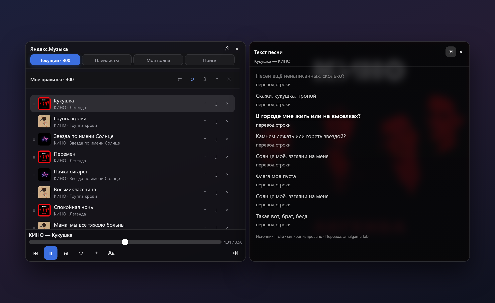
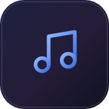
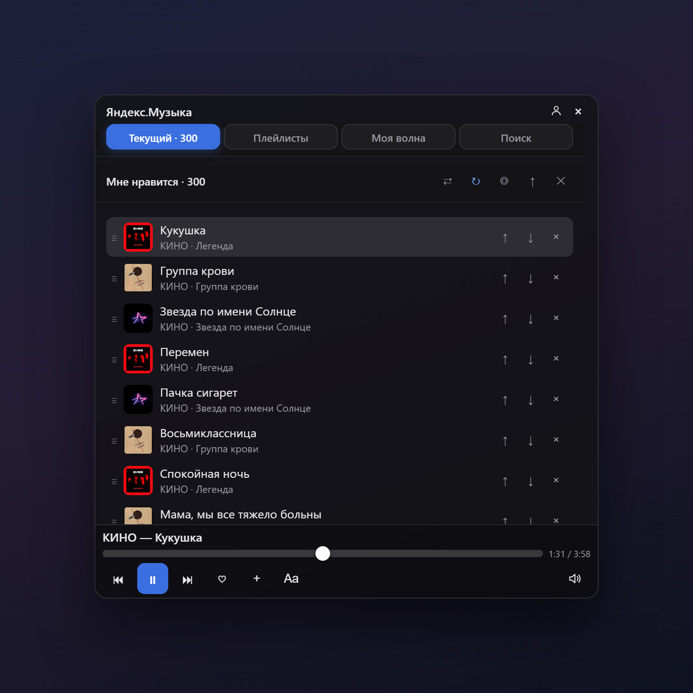
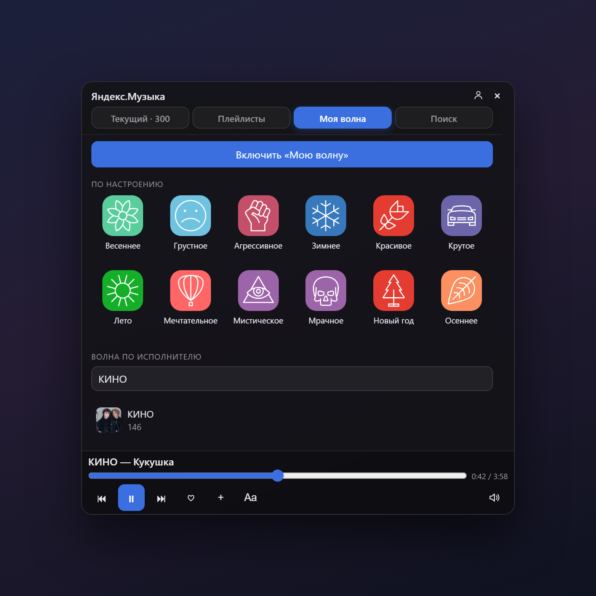
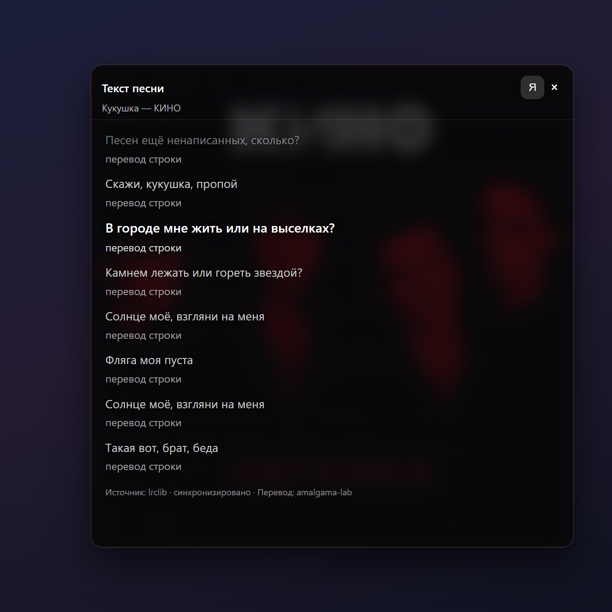

<p align="center">
  
</p>

<h1 align="center"><br>Яндекс.Музыка для DSH</h1>

<p align="center">
  Музыка прямо в боковой панели DeepSeek Harness — без переключения окон, вкладок и «сейчас открою браузер».
</p>

<p align="center">
  
  
  
  
</p>

---

## Зачем это

Вы просите агента что-то сделать, он думает три минуты, и всё это время вы
листаете что-нибудь в другом окне. Плагин закрывает ровно эту дырку: строка
**«Яндекс.Музыка»** появляется в самом низу боковой панели, рядом с аккаунтом.
Один клик — и над ней раскрывается плеер: поиск, очередь, плейлисты, волна и
текст песни.

Ничего не нужно настраивать вручную: вход через Яндекс, подписка Плюс
подхватывается сама. Токен живёт на вашем компьютере и никогда не попадает в
интерфейс.

> Нужен аккаунт Яндекса и подписка **Плюс** — без неё Яндекс отдаёт только
> 30-секундные превью.

## Как это выглядит

<p align="center">
  
  
</p>

<p align="center">
  <sub><b>Слева:</b> «Текущий» — очередь с перетаскиванием и живой счётчик. <b>Справа:</b> «Моя волна» — станции по настроению.</sub>
</p>

<p align="center">
  
</p>

<p align="center">
  <sub>Текст песни открывается отдельным окном впритык к плееру: обложка на фоне, строка подсвечивается в такт, снизу — перевод.</sub>
</p>

## Что умеет

### 🎵 Слушать
- Очередь с **перетаскиванием**: тащите трек мышью или жмите ↑ ↓.
- Повтор трека, повтор очереди, перемешивание — только того, что впереди.
- **Предзагрузка** следующего трека: между песнями почти нет паузы.
- Перезапустили DSH — плеер помнит, **на какой секунде** вы остановились, и
  продолжает оттуда.
- Громкость: клик по динамику — тишина, наведение — вертикальный ползунок.
  Колесо мыши на иконке тоже работает.

### ⌨️ Управлять не глядя
- **Медиаклавиши** и системный оверлей: название, исполнитель, обложка, ⏯ ⏭ ⏮.
- Горячие клавиши при открытом плеере: `Space` — играть/пауза, `←` `→` —
  перемотка на 5 секунд, `↑` `↓` — громкость, `M` — выключить звук.

### 🔎 Находить
- Поиск по трекам, исполнителям и альбомам.
- Отдельные страницы исполнителя и альбома: открыли — выбрали — слушаете.
- **Правая кнопка** на любом треке: «следующим», «в конец очереди»,
  «в плейлист», «в избранное», «к исполнителю», «скопировать ссылку».

### 🌊 Моя волна
- 700 станций из каталога Яндекса: **настроение, занятие, эпоха, жанры, язык**.
- Волна по любимому исполнителю: ввели имя — поехали.
- Пропуск и дизлайк уходят в Яндекс, поэтому волна постепенно становится вашей.

### 📚 Плейлисты
- Создание, переименование, приватность, удаление.
- Перестановка треков перетаскиванием, удаление одним нажатием.
- «Мне нравится» открывается сразу в «Текущем» — 300 ваших треков под рукой.

### 📝 Текст песни
- Отдельное окно впритык к плееру, фон — обложка трека.
- **Караоке**: строка подсвечивается по настоящим таймкодам, список сам
  подкручивается. Клик по строке — перемотка на неё.
- Если текст на иностранном языке, кнопка **«Я»** переводит его на русский:
  сначала ищется готовый литературный перевод, если его нет — машинный.

## Установка

**Способ 1 — из маркета.** Откройте каталог плагинов DSH, найдите
«Яндекс.Музыка» и нажмите «Установить». Перезапустите DSH.

**Способ 2 — из GitHub.**

```powershell
dsh plugin --profile desktop add github:breakc0re/dsh-yandex-music
```

Затем добавьте в `cordis.patch.yml` вашего профиля:

```yaml
- insert:
    - id: yandex-music
      name: dsh-yandex-music
```

и перезапустите DSH.

## Первый вход

1. Нажмите строку **«Яндекс.Музыка»** в подвале панели.
2. Плагин покажет короткий код — введите его на [ya.ru/device](https://ya.ru/device).
3. Готово. Подписка Плюс определится сама, полные треки включатся сразу.

Токен хранится в `<DSH_HOME>/plugin-data/dsh-yandex-music/auth.json` на вашем
компьютере. В интерфейс, в логи и в сеть он не уходит — только в сам Яндекс.

## Полезно знать

- **Где моя кнопка Remote Control?** Плагин занимает её место в подвале, а сам
  Remote Control переехал в меню **«Ещё»**.
- **Почему 30 секунд?** Значит не видна подписка Плюс. Проверьте, что вошли в
  тот аккаунт, где она есть: аватар в правом верхнем углу плеера.
- **Интерфейс прыгает?** Не должен: вкладки не перезагружаются при
  переключении, а списки показывают заглушки вместо «Ищем…».
- **Ничего не играет.** Яндекс Музыка — API без официальной поддержки; если
  перестанет отвечать, скорее всего дело в нём, а не в плагине.

## Приватность

Плагин обращается только к тому, что нужно для работы:

| Куда | Зачем | Что уходит |
| --- | --- | --- |
| `api.music.yandex.net` | музыка, поиск, плейлисты, волна | ваш токен и запрос |
| [lrclib.net](https://lrclib.net) | тексты песен с таймкодами | название трека и исполнитель |
| `translate.googleapis.com` | машинный перевод текста | текст песни |
| [amalgama-lab.com](https://www.amalgama-lab.com) | готовый литературный перевод | имя исполнителя и название |

Токен, логин и данные подписки не отправляются никуда, кроме Яндекса.

## Разработка

```
client.js        интерфейс: попап, плеер, очередь, волна, текст
server.js        маршруты /api/plugins/yandex-music/*
lib/yandex.js    поиск, страницы исполнителя и альбома, прямой URL трека
lib/playlists.js плейлисты: чтение, создание, правка, удаление
lib/rotor.js     «Моя волна» и каталог станций
lib/lyrics.js    LRCLIB и разбор LRC
lib/amalgama.js  готовые переводы
lib/translate.js машинный перевод
lib/oauth.js     токены: обновление и хранение
lib/device.js    вход через Device Flow
lib/store.js     файл авторизации
lib/cache.js     дисковый кэш
docs/            запись для маркета
```

Правки в исходниках подхватываются без пересборки — достаточно перезагрузить
окно DSH.

## Лицензия

[MIT](LICENSE) © 2026 breakc0re

Проект не связан с Яндексом. «Яндекс» и «Яндекс.Музыка» — товарные знаки
Яндекса. Плагин использует непубличный API и может перестать работать, если
Яндекс его изменит.
